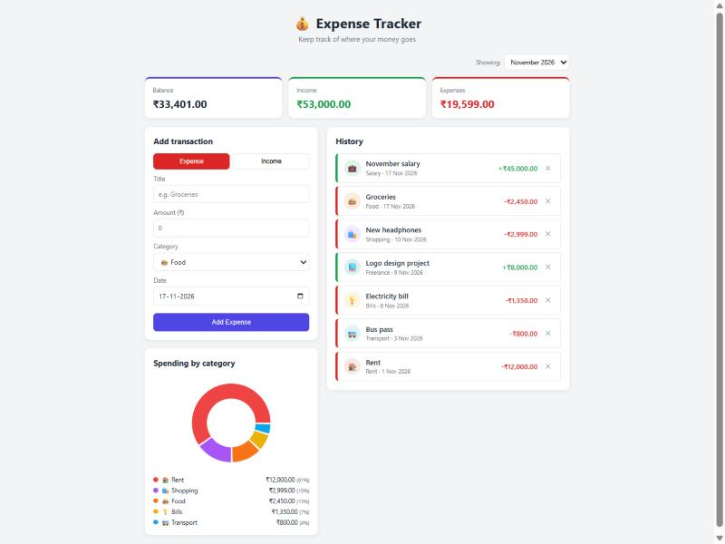

# 💰 Expense Tracker

A simple expense tracker built with **React** and **Vite**.
Add your income and expenses, see your balance, filter by month and find out where your money goes with a pie chart.

This is **Day 3** of my daily project challenge, where I build one project every day, from simple to advanced.

🔗 **Live demo:** https://gopichandreddy007.github.io/expense-tracker/



## Features

- Add income and expenses with a title, amount, category and date
- Different categories for income (Salary, Freelance, ...) and expenses (Food, Rent, Bills, ...)
- Balance, total income and total expense cards
- Filter by month or view all time
- Pie chart of spending by category, with percentages
- Delete transactions
- Data is saved in the browser (localStorage), so it stays after a refresh
- Form validation with clear error messages
- Amounts shown in Indian Rupees (₹)
- Responsive design for mobile, tablet and desktop
- Automatic deployment to GitHub Pages with GitHub Actions

## Tech Stack

- [React](https://react.dev/): components and hooks (`useState`, `useEffect`)
- [Vite](https://vite.dev/): dev server and build tool
- [Recharts](https://recharts.org/): pie chart
- CSS (Flexbox, Grid, media queries, CSS variables)
- GitHub Actions + GitHub Pages: hosting

## Project Structure

```
expense-tracker/
├── src/
│   ├── components/
│   │   ├── TransactionForm.jsx   # add income / expense
│   │   ├── TransactionList.jsx   # history list with delete
│   │   ├── Summary.jsx           # balance, income, expense cards
│   │   ├── MonthFilter.jsx       # month dropdown
│   │   └── ExpenseChart.jsx      # pie chart by category
│   ├── App.jsx                   # main state and layout
│   ├── categories.js             # category names, icons and colors
│   ├── utils.js                  # money and date helpers
│   ├── index.css                 # all styles
│   └── main.jsx
├── .github/workflows/deploy.yml  # GitHub Pages deployment
└── vite.config.js
```

## Run Locally

```bash
git clone https://github.com/gopichandreddy007/expense-tracker.git
cd expense-tracker
npm install
npm run dev
```

Then open the link shown in the terminal (usually http://localhost:5173/expense-tracker/).

Other commands:

| Command           | What it does                    |
| ----------------- | ------------------------------- |
| `npm run build`   | Build the app into `dist/`      |
| `npm run preview` | Preview the production build    |
| `npm run lint`    | Check the code with oxlint      |

## What I Learned

- Splitting a UI into small React components and passing data with props
- Lifting state up so the form, list, summary and chart share the same data
- Saving and loading state with `localStorage` and `useEffect`
- Deriving data (totals, month list, chart data) from state instead of storing it twice
- Using a chart library (Recharts)
- Working with dates in the local timezone instead of UTC
- Deploying a Vite app to GitHub Pages with GitHub Actions

## Future Ideas

- Edit existing transactions
- Monthly budget limits with warnings
- Export transactions to CSV
- Dark mode
